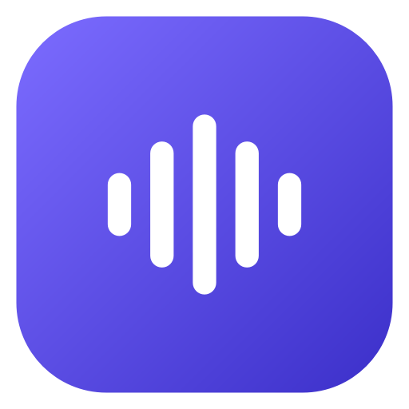
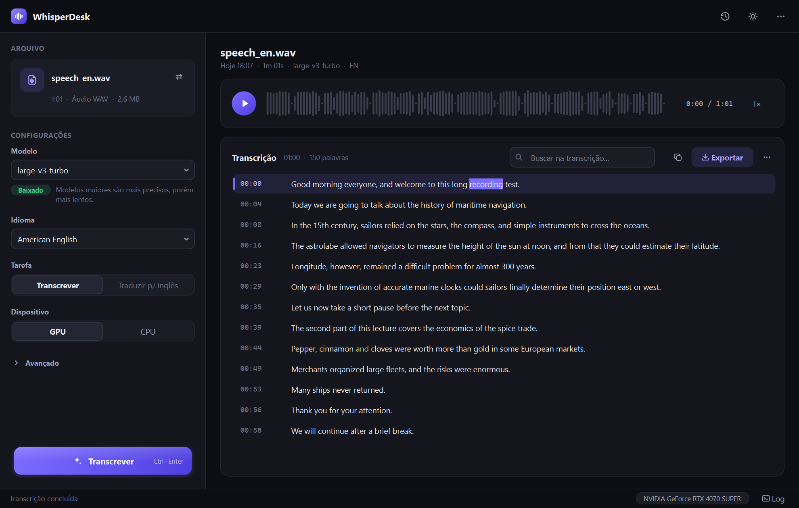
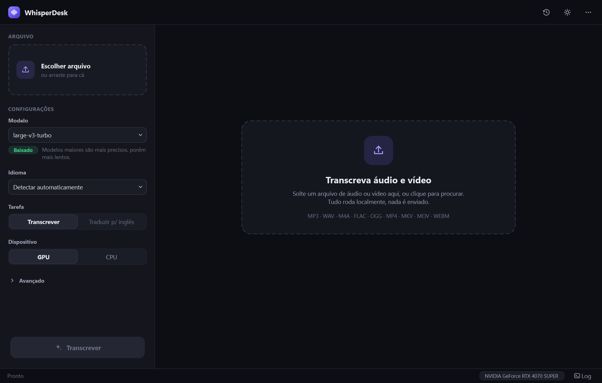
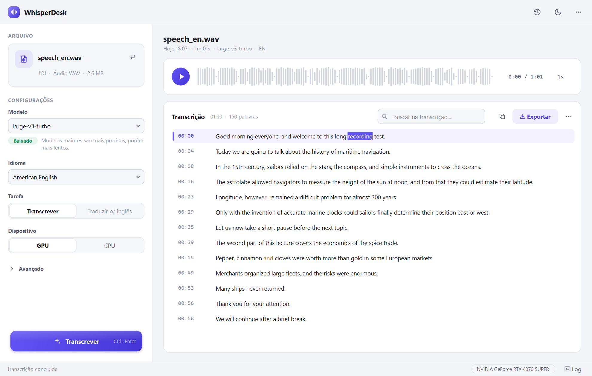
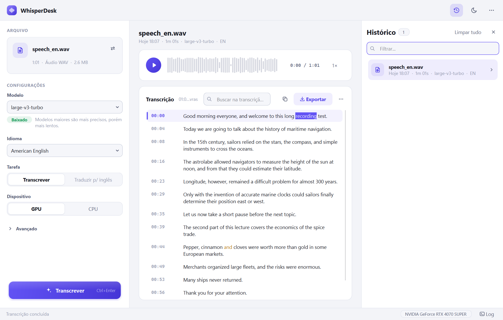
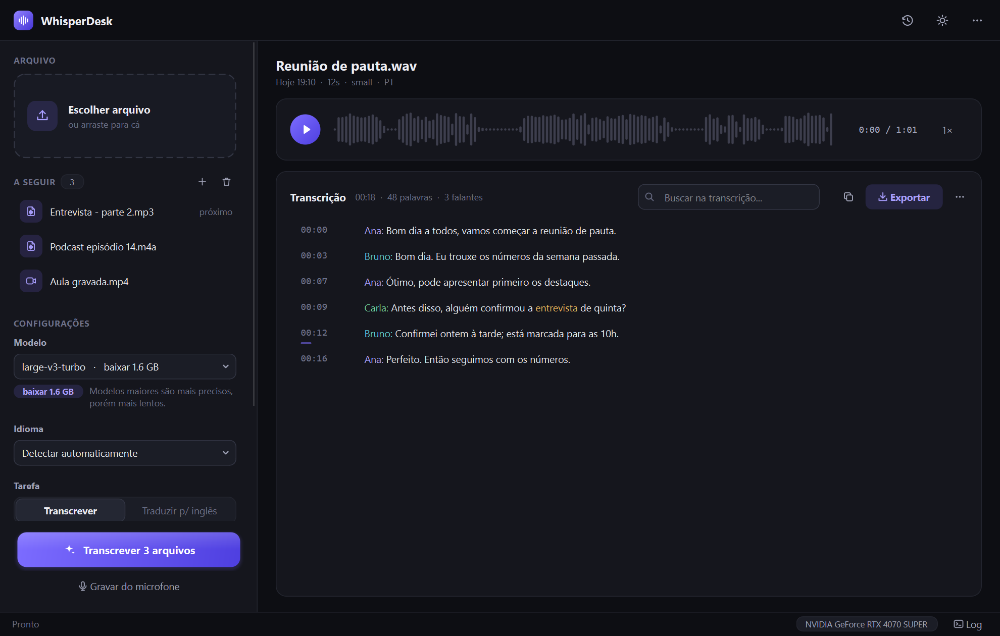
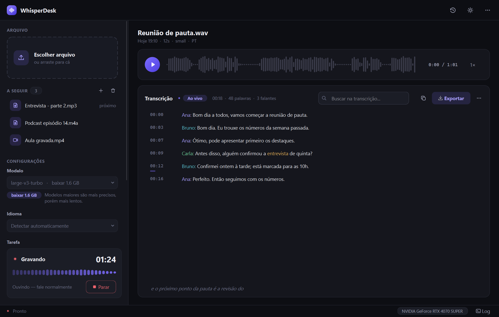

<div align="center">



# WhisperDesk

**Transcrição de áudio e vídeo 100% local para Windows, Linux e macOS, com Whisper e aceleração NVIDIA CUDA.**

Seu áudio nunca sai do computador.


**[⬇ Baixar (Windows, Linux, macOS)](../../releases/latest)**

<br>



</div>

> **English summary** — WhisperDesk is a private, offline desktop transcriber for Windows, Linux and macOS built on
> [faster-whisper](https://github.com/SYSTRAN/faster-whisper) (CTranslate2) and Qt 6. Drop in any audio or video file,
> get an accurate, timestamped transcript with a synced player, search, and export to TXT/SRT/VTT/JSON/CSV.
> Long recordings (hours) are processed in silence-aligned chunks with an on-disk journal, so a crash, a reboot or a
> pause never loses finished work. Low-confidence passages are re-checked with the surrounding conversation as
> context and offered as suggestions you accept or keep. NVIDIA GPUs are used automatically (the CUDA libraries are a
> one-time optional download), with a transparent fallback to the CPU. The only network access is the one-time
> download of each model and, if you accept it, of the GPU pack.

---

## Sumário

- [O que é](#o-que-é)
- [Escopo do projeto](#escopo-do-projeto)
- [Recursos](#recursos)
- [Revisão contextual](#revisão-contextual)
- [Interface](#interface)
- [Instalação](#instalação)
- [Aceleração por GPU](#aceleração-por-gpu)
- [Modelos](#modelos)
- [Onde ficam os dados](#onde-ficam-os-dados)
- [Diagnóstico](#diagnóstico)
- [Desenvolvimento](#desenvolvimento)
- [Build de distribuição](#build-de-distribuição)
- [Arquitetura](#arquitetura)
- [Roadmap](#roadmap)
- [Licenças](#licenças)

## O que é

O WhisperDesk é um aplicativo de desktop para transformar gravações — reuniões, aulas, entrevistas, podcasts, vídeos —
em texto pesquisável e legendas, sem enviar nada para a nuvem. Ele empacota o modelo Whisper da OpenAI (via
faster-whisper / CTranslate2) e as bibliotecas do FFmpeg (via PyAV) num pacote único: o usuário final não precisa
instalar Python, CUDA Toolkit nem FFmpeg.

## Escopo do projeto

**Dentro do escopo**

- Transcrição **offline** de qualquer áudio ou vídeo que o FFmpeg leia, em ~100 idiomas, com detecção automática.
- Tradução de fala para **inglês** (modelos que suportam a tarefa).
- Gravações **longas** (de minutos a 12 h ou mais) e arquivos de dezenas de GB, com uso de memória constante.
- **Robustez de produção**: trabalhos retomáveis após pausa, fechamento do app, queda de energia ou travamento do worker.
- Uso automático de **GPU NVIDIA** (Windows e Linux), com redução de precisão e volta para a CPU quando falta VRAM.
- Revisão do resultado: player sincronizado, busca, cores por confiança, **sugestões para trechos duvidosos**,
  **edição do texto** e exportação para formatos de legenda e dados.
- **Identificação de falantes** (diarização local) e **transcrição ao vivo do microfone**.
- **Fila** de vários arquivos, transcritos um depois do outro.
- Distribuição para **Windows 10/11 x64** (instalador por usuário, sem UAC), **Linux x64** (`.tar.gz`) e
  **macOS Apple Silicon** (`.dmg`), gerados pelo GitHub Actions.

**Fora do escopo (por decisão)**

- Serviços em nuvem, contas, telemetria ou qualquer envio de áudio/texto para fora da máquina.
- Android/iOS.
- Edição de vídeo ou queima de legendas no vídeo.

## Recursos

- **Arrastar e soltar** em qualquer ponto da janela, "Abrir com" no gerenciador de arquivos (Explorer, Finder, Linux)
  ou instância única que recebe novos arquivos; escolha da faixa de áudio em vídeos com várias faixas.
- **Arquivos longos** divididos em blocos cortados nos silêncios (Silero VAD). Cada bloco concluído é gravado num diário
  SQLite: dá para pausar, fechar o app ou sobreviver a uma queda e retomar do último bloco.
- **Worker em processo separado** (`spawn`): um travamento do modelo nunca derruba a interface.
- **GPU NVIDIA** em float16 / int8_float16 com fallback automático para CPU se faltar VRAM ou a GPU falhar.
- **Filtro de alucinações** (repetições em loop, "Obrigado por assistir" em silêncio etc.).
- **Resultado interativo**: timestamps clicáveis, destaque palavra a palavra sincronizado com o player, cores por
  confiança, busca com navegação entre resultados.
- **Revisão contextual** dos trechos em vermelho (veja abaixo), com sugestões que você aceita ou descarta.
- **Edição no próprio resultado**: clique no lápis (ou `F2`), corrija o texto e `Enter` salva; os tempos das palavras
  são preservados ou redistribuídos, e o original pode ser restaurado. As exportações já saem com as correções.
- **Identificação de falantes**: opção "Identificar falantes" antes de transcrever, ou depois, em **⋯ → Identificar
  falantes** num resultado pronto. Roda localmente (modelo de voz WeSpeaker de ~26 MB, baixado uma vez), com número de
  falantes automático ou fixo. Cada falante ganha uma cor; dá para renomear ("Falante 1" → "Ana") e trocar o falante de
  um trecho pelo menu de contexto. Os nomes vão para TXT, SRT, VTT, JSON e CSV.
- **Ao vivo pelo microfone** (`Ctrl+R`): o texto aparece enquanto você fala, com uma linha provisória em itálico que se
  firma ao fim de cada frase. A gravação fica salva em WAV, vira um item do histórico e pode ser reexportada ou
  ter os falantes identificados depois. Microfone escolhido em **⋯ → Microfone**.
- **Fila de arquivos**: selecione ou arraste vários arquivos (ou uma pasta). O primeiro é carregado e os demais vão para
  "A seguir", na barra lateral; ao terminar um, o próximo começa sozinho. Arquivos já transcritos são pulados, falhas
  não interrompem a fila, e ela sobrevive ao fechamento do app.
- **Exportação** TXT, SRT, VTT, JSON e CSV (escrita atômica).
- **Histórico** de transcrições com filtro, tema claro/escuro e interface em português, inglês e espanhol (segue o
  sistema).
- **Diagnóstico embutido**: `--selftest` e `--selftest-transcribe` para suporte e CI.

## Revisão contextual

Palavras com confiança baixa aparecem em vermelho. Com **Revisar trechos duvidosos** ligado (padrão), ao fim da
transcrição o app volta a cada trecho em vermelho e o retranscreve sozinho, com uma folga de áudio dos dois lados e
com o contexto da conversa:

- as **frases anteriores** entram como contexto (sem as palavras duvidosas, para o erro não se propagar);
- os **termos que a própria gravação já fixou com confiança** — nomes próprios, termos técnicos que se repetem —
  entram como vocabulário preferido.

Cada alternativa é comparada com o original pela confiança das palavras. Só vira sugestão o que muda o texto e é
claramente mais provável; ecos do contexto e repetições degeneradas são descartados. **Nada é trocado sem você
aceitar**: a sugestão aparece logo abaixo do trecho, com as palavras alteradas em destaque e os botões **Aceitar** e
**Manter**. Uma faixa no topo do resultado conta as sugestões, navega entre elas e permite aceitar ou manter todas.
Aceitar vira uma edição comum (dá para restaurar o original); trechos que você já decidiu ou editou não são
revisitados. A revisão também pode ser rodada depois, em **⋯ → Revisar trechos duvidosos**.

## Interface

A versão 2.0 trouxe uma interface redesenhada, pensada como produto:

- Layout em duas áreas — **configurações à esquerda**, **documento à direita** — com o botão principal sempre no mesmo lugar.
- Tela inicial com uma grande área de soltar arquivos e a lista de **recentes**.
- **Player com forma de onda** (clique para pular, bolha de tempo no hover, velocidades de 0,75× a 2×).
- Gavetas animadas para **histórico** e **log técnico**, sem espremer o conteúdo.
- Temas **claro e escuro** com paletas próprias e transição em cross-fade.
- Animações discretas: seletores com pílula deslizante, carregamento em esqueleto, progresso suavizado, notificações.
- Atalhos: `Ctrl+O` abrir, `Ctrl+Enter` transcrever, `Ctrl+R` gravar do microfone, `Ctrl+E` exportar, `Ctrl+F`
  buscar, `F2` editar trecho, `Ctrl+H` histórico, `Ctrl+L` log, `Espaço` / `←` / `→` player, `Esc` fecha gavetas.

Na 2.1 e na 2.2, os elementos novos seguem a mesma linguagem: as linhas da fila entram e saem deslizando, o editor
surge com um fade curto, o medidor do microfone sobe rápido e desce devagar, e as sugestões da revisão contextual
aparecem num fade suave quando a transcrição termina — movimento para orientar, nunca para enfeitar.

| Tela inicial (escuro) | Transcrição (claro) | Histórico (claro) |
|:---:|:---:|:---:|
|  |  |  |

| Falantes, edição e fila (2.1) | Ao vivo pelo microfone (2.1) |
|:---:|:---:|
|  |  |

## Instalação

Baixe o pacote do seu sistema na página de [Releases](../../releases). Os SHA-256 de cada arquivo estão na própria
release.

| Sistema | Arquivo | Como instalar |
|---|---|---|
| Windows 10/11 x64 | `WhisperDesk-2.2.0-setup-x64.exe` | Execute o instalador (por usuário, não pede administrador). |
| Linux x64 (glibc 2.35+, ex.: Ubuntu 22.04+, Fedora 36+) | `WhisperDesk-2.2.0-linux-x86_64.tar.gz` | Extraia, rode `./WhisperDesk` — ou `./install.sh` para criar o atalho no menu. |
| macOS 12+ (Apple Silicon) | `WhisperDesk-2.2.0-macos-arm64.dmg` | Abra o `.dmg` e arraste o WhisperDesk para Aplicativos. |

Depois, abra o WhisperDesk, solte um arquivo e clique em **Transcrever**. O modelo escolhido é baixado na primeira vez.

> [!NOTE]
> **Windows: aviso "O Windows protegeu o computador"**
>
> O WhisperDesk é um software novo, gratuito e ainda sem certificado de assinatura pago, por isso o SmartScreen
> do Windows mostra esse alerta ao abrir o instalador. Para continuar, clique em **Mais informações** e depois em
> **Executar assim mesmo**.
>
> O alerta diminui sozinho: o SmartScreen ganha confiança no arquivo conforme mais pessoas o baixam e executam sem
> problemas (até programas assinados com certificados comuns passam por isso no início). Se preferir conferir o
> arquivo antes, compare o SHA-256 dele com o publicado na página da release
> (`Get-FileHash .\WhisperDesk-2.2.0-setup-x64.exe`) ou leia o código-fonte deste repositório.
>
> **macOS: "não é possível verificar o desenvolvedor"**
>
> O app tem assinatura ad-hoc, mas não é notarizado pela Apple. Na primeira vez, clique com o botão direito no
> WhisperDesk em Aplicativos → **Abrir** → **Abrir** (ou, em Ajustes do Sistema → Privacidade e Segurança, **Abrir
> Mesmo Assim**). Para o modo ao vivo, o macOS pede permissão de microfone.

**Requisitos**

- Windows 10 1809+ / 11 (x64), Linux x64 com glibc 2.35+ ou macOS 12+ em Apple Silicon.
- Opcional: GPU NVIDIA com driver **525 ou mais novo** (CUDA 12), no Windows ou no Linux. Sem GPU, o app usa a CPU
  (no Mac, a CPU do Apple Silicon).
- Espaço em disco: ~300 MB do app + o modelo escolhido (75 MB para o `tiny`, ~1,6 GB para o `large-v3-turbo`,
  ~3 GB para o `large-v3`) + o pacote GPU, se instalado.

## Aceleração por GPU

Desde a 2.2, as bibliotecas CUDA (cuBLAS e, no Linux, cuDNN) **não vêm mais dentro do instalador**, que ficou cerca
de 8× menor (611 MB → 80 MB). Só quem tem placa NVIDIA precisa delas: ao abrir o app numa máquina com GPU NVIDIA, ele oferece baixar o
**pacote GPU** uma única vez (~530 MB no Windows, ~1,2 GB no Linux). Se você recusar, o rodapé continua mostrando
"CPU · Baixar pacote de GPU" para fazer isso depois.

O pacote vem das wheels oficiais da NVIDIA no PyPI, com versão e SHA-256 fixados no código
([app/gpu_pack.py](app/gpu_pack.py)); só os arquivos necessários são extraídos para a pasta de dados. O download é
retomável e, ao terminar, a GPU fica disponível na hora, sem reiniciar.

## Modelos

| Modelo          | Download   | Uso sugerido                                                            |
|-----------------|------------|-------------------------------------------------------------------------|
| tiny / base     | 75–145 MB  | testes, máquinas fracas                                                 |
| small / medium  | 0,5–1,5 GB | boa qualidade em CPU                                                    |
| large-v3-turbo  | ~1,6 GB    | **padrão**: quase a qualidade do large-v3, bem mais rápido (não traduz) |
| large-v2 / v3   | ~3 GB      | máxima qualidade e tradução para inglês                                 |

Os modelos vêm do Hugging Face (formato CTranslate2); o download é retomado de onde parou.

## Onde ficam os dados

| O quê | Windows | Linux | macOS |
|---|---|---|---|
| Configurações | `%APPDATA%\WhisperDesk` | `~/.config/WhisperDesk` | `~/Library/Application Support/WhisperDesk` |
| Modelos, trabalhos, logs, gravações, pacote GPU | `%LOCALAPPDATA%\WhisperDesk` | `~/.local/share/WhisperDesk` | `~/Library/Application Support/WhisperDesk` |

Dentro da pasta de dados: `models`, `jobs` (trabalhos retomáveis e histórico), `logs` (`app.log`, `worker-*.log`,
`crash.log`), `recordings` (gravações do microfone) e `gpu` (pacote GPU). O menu **⋯ → Pasta de dados** abre esse
diretório. A variável `WHISPERDESK_HOME` redireciona tudo para outra pasta (modo portátil). O desinstalador do
Windows pergunta se esses dados devem ser apagados.

## Diagnóstico

```bat
WhisperDesk.exe --selftest --out selftest.json
WhisperDesk.exe --selftest-transcribe arquivo.mp3 --model tiny --device cuda --out resultado.json
```

(No Linux: `./WhisperDesk --selftest`; no macOS: `WhisperDesk.app/Contents/MacOS/WhisperDesk --selftest`.)

O primeiro verifica a biblioteca de mídia (PyAV/FFmpeg), o CTranslate2, as bibliotecas CUDA e o pacote GPU, o VAD e
a GPU. O segundo transcreve um arquivo sem interface (gera `.json` e `.srt`). Ambos retornam código 0 em caso de
sucesso.

**Problemas comuns**

- *"CUDA indisponível"*: atualize o driver NVIDIA (≥ 525) e confira se o pacote GPU foi instalado (rodapé do app).
  O app continua funcionando na CPU.
- *Falta de VRAM*: use `int8_float16` ou um modelo menor; o app já tenta isso sozinho e, em último caso, passa para a CPU.
- *Falha no download do modelo ou do pacote GPU*: verifique proxy/firewall para `huggingface.co` e
  `files.pythonhosted.org`.
- *Linux sem janela / erro do plugin "xcb"*: instale `libxcb-cursor0` (Debian/Ubuntu) ou `xcb-util-cursor` (Fedora).
- Em qualquer falha, o diálogo de erro mostra o caminho do log do trabalho.

## Desenvolvimento

Requer Python 3.12 (64 bits).

```bat
:: Windows
install.bat                      :: cria .venv e instala requirements-dev.txt
.venv\Scripts\python.exe main.py
.venv\Scripts\python.exe -m pytest -q tests
```

```sh
# Linux / macOS
python3.12 -m venv .venv && .venv/bin/pip install -r requirements-dev.txt
.venv/bin/python main.py
QT_QPA_PLATFORM=offscreen .venv/bin/python -m pytest -q tests
```

Não é preciso instalar o FFmpeg: a mídia é lida pelo PyAV. Para testar GPU sem passar pelo download do app,
instale `requirements-gpu.txt` no venv.

## Build de distribuição

```bat
build.bat [--skip-tests]          :: Windows: pasta dist\WhisperDesk\ + instalador Inno Setup
```

```sh
./build.sh [--skip-tests]         # Linux: .tar.gz · macOS: .app com assinatura ad-hoc + .dmg
```

Etapas: testes → PyInstaller (`WhisperDesk.spec`, onedir, sem UPX, com poda das partes do Qt que um app de widgets
não usa) → `--selftest` do executável → pacote (Inno Setup 6 no Windows, `tar.gz` no Linux, `.dmg` no macOS).

O workflow [`.github/workflows/build.yml`](.github/workflows/build.yml) roda os testes no Windows, Linux e macOS a cada
push e, em tags `v*`, gera os três pacotes e anexa ao release com os SHA-256.

Os binários publicados não são assinados com certificado pago (veja a nota em [Instalação](#instalação)). Quem
quiser assinar a própria build pode usar `signtool sign /fd sha256 /tr http://timestamp.digicert.com /td sha256 ...`
no Windows ou `codesign` + `notarytool` no macOS.

**Tamanho do instalador do Windows**

| Versão | Instalador | Instalado | O que mudou |
|---|---|---|---|
| 2.1.0 | 611 MB | 1,5 GB | ffmpeg.exe + ffprobe.exe (435 MB) e cuBLAS (736 MB) embutidos |
| 2.2.0 | 80 MB | 303 MB | mídia via PyAV, CUDA sob demanda, Qt podado |

## Arquitetura

```
main.py                 entrada: GUI com instância única, --selftest, --selftest-transcribe
app/runtime.py          bibliotecas CUDA (pacote GPU, venv ou sistema) para dev e para o executável congelado
app/gpu_pack.py         download verificado do pacote GPU (wheels NVIDIA do PyPI, SHA-256 fixado)
app/paths.py            pastas de dados por usuário (Windows, XDG no Linux, Application Support no macOS)
app/pipeline/
  ffmpeg_tools.py       probe, extração de WAV 16 kHz, picos da forma de onda (PyAV, sem processos externos)
  planner.py            divide o áudio em blocos nos silêncios (Silero VAD)
  worker.py             processo de transcrição isolado (spawn), checkpoint por bloco, fallback GPU→CPU
  refine.py             revisão contextual dos trechos de baixa confiança (sugestões)
  live_worker.py        transcrição ao vivo: detector de voz, linha provisória e frases finais no diário
  diarize.py            identificação de falantes (embeddings WeSpeaker via onnxruntime + agrupamento)
  journal.py            diário SQLite (WAL) dos blocos e sugestões — retomada após pausa ou queda
  hallucination.py      filtro de alucinações
  segmenter.py          re-segmentação para legendas
  exporters.py          TXT/SRT/VTT/JSON/CSV (escrita atômica)
  service.py            identidade de trabalhos, histórico, sugestões, exportação
  models.py             catálogo e download de modelos
app/core/               player de áudio, monitor de GPU (NVML)
app/gui/
  theme.py              tokens de design (claro/escuro) e folha de estilo
  widgets.py            componentes animados (botões, seletores, toasts, gavetas, progresso)
  main_window.py        janela, layout, atalhos, arrastar e soltar
  result_view.py        lista virtualizada de segmentos, busca, karaokê, edição inline, falantes, sugestões
  gpu_pack_ui.py        oferta e download do pacote GPU em segundo plano
  queue_list.py         fila de arquivos ("A seguir")
  live.py               captura do microfone (QtMultimedia), medidor de nível e painel ao vivo
  player_controls.py    player com forma de onda
  history.py            histórico e recentes
  job_controller.py     ponte entre a UI e o processo worker
app/utils/              configuração, i18n (pt/en/es), forma de onda, integração com o sistema (desktop.py)
tools/                  make_icon.py
packaging/              manifesto, version info, avisos de terceiros, atalho .desktop do Linux
installer/              script do Inno Setup
tests/                  pytest (pipeline, mídia, serviço, revisão contextual, pacote GPU)
docs/                   auditoria de produção e arquitetura-alvo
```

Fluxo de um trabalho: o arquivo é inspecionado (PyAV) → o áudio é extraído para WAV 16 kHz mono, mantendo o relógio
do container → o planner corta blocos nos silêncios → o worker (processo separado) transcreve bloco a bloco, gravando
cada um no diário → a UI recebe os segmentos em tempo real → os trechos duvidosos são revisados com contexto → ao
fim, o resultado vai para o histórico e pode ser exportado.

## Roadmap

- [ ] Assinatura digital do executável e do instalador (Windows) e notarização (macOS)
- [x] Revisão contextual de trechos de baixa confiança — 2.2
- [x] Linux e macOS, com builds no GitHub Actions — 2.2
- [x] Instalador menor (mídia via PyAV, CUDA sob demanda) — 2.2
- [x] Diarização (quem falou o quê) — 2.1
- [x] Transcrição em tempo real do microfone — 2.1
- [x] Editor de texto do resultado com reexportação — 2.1
- [x] Fila de vários arquivos — 2.1

## Licenças

O código do WhisperDesk é distribuído sob a [licença MIT](LICENSE).

Os componentes de terceiros incluídos no build mantêm as próprias licenças — veja
[packaging/THIRD_PARTY_NOTICES.txt](packaging/THIRD_PARTY_NOTICES.txt). As bibliotecas do FFmpeg (via PyAV) são
GPL v3 e ficam em bibliotecas separadas; o Qt é LGPL v3 e fica em bibliotecas substituíveis. As bibliotecas CUDA da
NVIDIA não são distribuídas: são baixadas pelo próprio usuário, sob a licença da NVIDIA.
